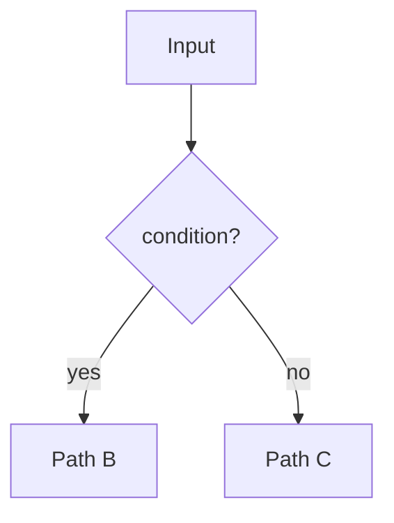
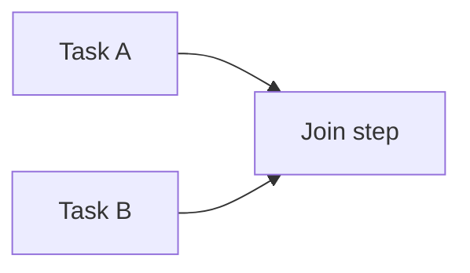
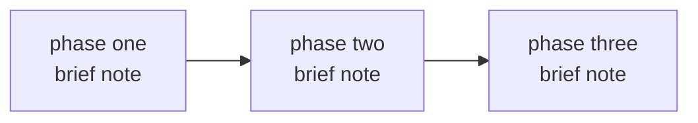
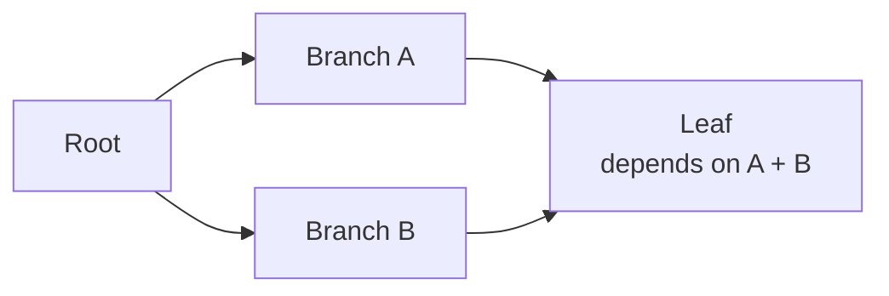

## Principles

**1\. Lead with why, not what.** The first paragraph answers: what problem does this system solve and why does it exist as a separate concern? Never start with implementation details.

**2\. One diagram per concept.** Each diagram should capture exactly one idea — a pipeline, a lifecycle, a data flow, a concurrency shape. If you need to explain two things, use two diagrams. Do not combine.

**3\. Node labels are names, not sentences.** A node label is 1–4 words. If a node needs more explanation, write it in prose below the diagram. The diagram is a map; the prose is the legend.

```plaintext
Good:  ["Emit event"]
Bad:   ["Emit the ready event to the frontend so it can render the approval UI"]
```

**4\. Use** `<br>` **for multi-line node labels, never** `\n`**.** Mermaid requires `<br>` inside node strings. `\n` breaks rendering silently.

```plaintext
Good:  ["Write record<br>status: pending"]
Bad:   ["Write record\nstatus: pending"]
```

**5\. No file paths or implementation locations.** Docs describe architecture, not source layout. Omit file names, module paths, and line numbers entirely. Readers derive those from the code.

**6\. Notes below diagrams answer: what is non-obvious?** After a diagram, write only what the diagram cannot show — edge cases, invariants, design constraints, timing. Do not restate what the diagram already makes clear.

**7\. Tables for reference data.** Use tables for field schemas, event inventories, and comparison grids. Use prose for everything else.

**8\. Design decisions go at the end, in bold-question format.** Collect every "why did we do it this way" into a final section. Format each as a bold question followed by a one-paragraph answer. This separates reasoning from description and makes the doc scannable.

**9\. No** `---` **between sections. No trailing headers like "Summary" or "Conclusion".** Section breaks are handled by heading hierarchy alone. The doc ends when the content ends.

**10\. Heading hierarchy:** `##` **for major phases,** `###` **for sub-concepts within a phase.** Never use `####` or deeper in architecture docs — if you need it, the section should be its own `##`.

## Diagram Cheat Sheet

### Linear pipeline

```plaintext
flowchart TD
    A["Step one"] --> B["Step two"]
    B --> C["Step three"]
```

### Branch / decision



### Parallel then join



### Lifecycle phases (left to right)



### Fan-out DAG



Use `TD` (top-down) for pipelines and approval flows. Use `LR` (left-right) for lifecycles, DAGs, and data flows where sequence is the primary concern.

## Doc Scaffold

Copy this skeleton and fill in each section. Delete sections that do not apply.

```markdown
# [System Name] — Deep Dive

[One paragraph: what this system is, when it activates, and why it exists as a separate concern from the simpler path.]

## Why a Separate [System/Mode/Layer]

[One paragraph: what breaks without this, what problem it solves that the simpler path cannot.]

## [Phase or Concept 1]

[One sentence framing the phase.]

[diagram]

[Notes: only what the diagram cannot show.]

## [Phase or Concept 2]

[One sentence framing the phase.]

[diagram]

[Notes.]

### [Sub-concept within Phase 2]

[diagram or prose]

[Notes.]

## [Reference section — events, fields, errors]

| Column | Column | Column |
|---|---|---|
| ... | ... | ... |

## [Failure / Interruption Handling]

[diagram or prose]

## Design Decisions

**Why [decision one]?** [One paragraph answer.]

**Why [decision two]?** [One paragraph answer.]
```
