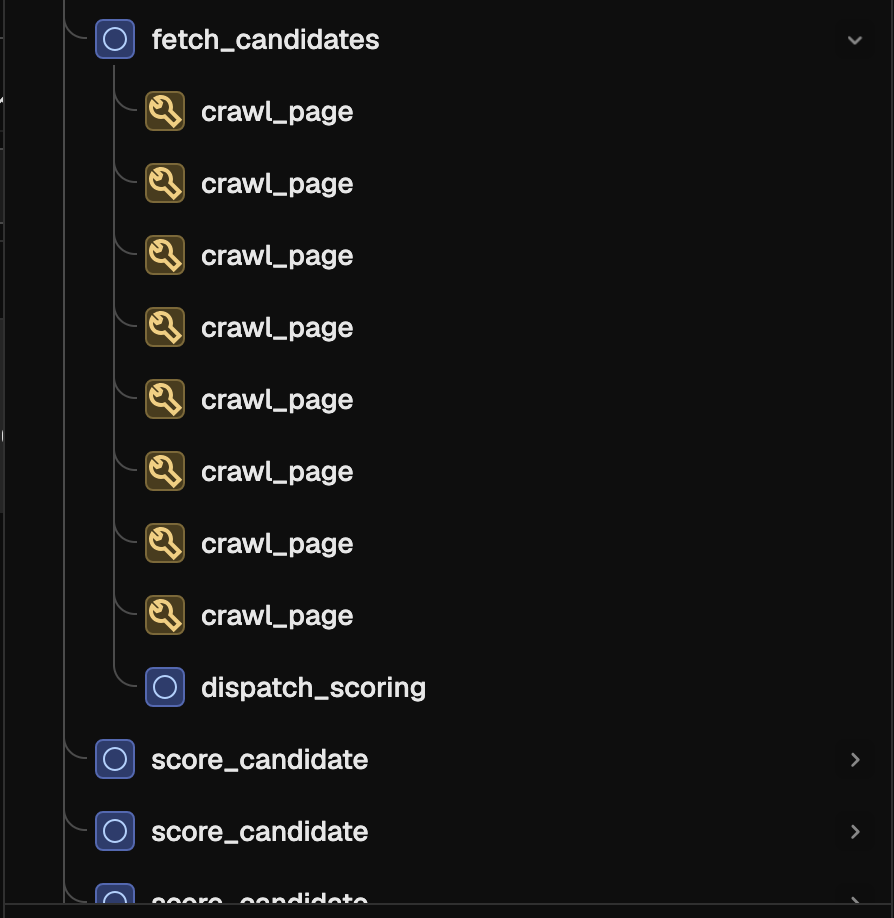

# There's no such thing as a trace: making sense of spans, traces, and sessions

I was building a bookmark recommendation project, my first project with observability, and using Phoenix to see what it was doing. What confused me was the relation between spans and traces. In theory I could understand it, but in the tool it was confusing. I read their blog post, [LLM Tracing and Observability](https://arize.com/blog/llm-tracing-and-observability-with-arize-phoenix/), and it didn't make much sense.

A while later I came across a short video by Mikio from Arize, [OpenTelemetry Concepts for AI: Span, Trace, Session](https://www.youtube.com/watch?v=7XgNHzHXeaM), and it all made sense. He starts in Phoenix itself. Open Phoenix, go to the Spans tab with the "root spans only" filter on, then click over to the Traces tab. The two lists look the same. The answer is simpler than two tabs suggest: the root spans are the traces, because a trace isn't stored anywhere as its own thing.

What follows is how the video explains it, checked against the OpenTelemetry and Phoenix docs.

## A span is a span of time

A span records one unit of work. It opens when the work starts and closes when it ends.

Take an app with three parts: a client, a server, and a database. A request hits the client, which opens a span. The client calls the server, and the server opens its own span. The server queries the database, and that call gets a span too. Then they close in reverse order: database, server, client.

```text
time ─────────────────────────────────────────────▶
client    [=========================================]
server         [===========================]
database             [==========]
```

Each bar is one span. The longer bars contain the shorter ones, because the client can't finish until the server answers, and the server can't finish until the database does.

Every span has its own ID. It also carries a trace ID, and that's what holds the request together.

## The trace is just a shared ID

There's no trace record that spans belong to. You get spans, each with a `trace_id` and, except for the first one, a `parent_id` pointing at the span that called it. The [OpenTelemetry spec](https://opentelemetry.io/docs/reference/specification/overview/) says traces are "defined implicitly by their Spans."

The [OTel docs](https://opentelemetry.io/docs/concepts/signals/traces/) show it with a small example. Two of its spans, trimmed:

```json
{ "name": "hello",
  "context": { "trace_id": "5b8aa5a2d2c872e8321cf37308d69df2", "span_id": "051581bf3cb55c13" },
  "parent_id": null }

{ "name": "hello-greetings",
  "context": { "trace_id": "5b8aa5a2d2c872e8321cf37308d69df2", "span_id": "5fb397be34d26b51" },
  "parent_id": "051581bf3cb55c13" }
```

Same `trace_id`. The second span's `parent_id` is the first span's `span_id`. The first has no parent, so it's the root span. That's all a trace is.

So the Phoenix mystery goes away. The Traces tab groups spans by trace ID and draws the parent-child tree. The Spans tab with "root spans only" shows one span per trace, the root, so you get the same rows. Turn the filter off and you see every span, and clicking any of them shows the trace ID that ties it to the rest.

One side effect I wouldn't have guessed: since nothing closes a trace, it keeps growing as long as new spans show up with its trace ID.

How does the server learn the client's trace ID in the first place? The caller sends it along with the request. OpenTelemetry calls this context propagation. Over HTTP the W3C standard is the `traceparent` header, shaped `VERSION-TRACE_ID-PARENT_SPAN_ID-TRACE_FLAGS`, and the OpenTelemetry libraries usually add it for you.

## Where this matters: crawl spans that would start their own traces

My bookmark recommender is a LangGraph app, traced with OpenInference's LangChain instrumentor. Some of its nodes crawl pages, and I wrapped those crawls in spans of my own. Left alone, those crawl spans would start new traces instead of nesting under their node. I added one extra step from the beginning, and in Phoenix they sit where they belong:



Here's where a crawl span gets created, trimmed from my crawler class (it uses [Crawl4AI](https://github.com/unclecode/crawl4ai)):

```python
tracer = OITracer(trace.get_tracer(__name__), TraceConfig())


async def fetch_page(self, url: str, limit: int) -> PageContent:
    with tracer.start_as_current_span("crawl_page", openinference_span_kind="tool") as span:
        span.set_input(url)
        try:
            page = to_page(url, await self._crawler.arun(url, config=RUN_CONFIG), limit)
        except Exception as e:  # a broken page must not end the turn; it is recorded on the span
            span.record_exception(e)
            page = PageContent(url=url, ok=False, error=str(e))
        span.set_output({"title": page.title, "chars": len(page.markdown), "ok": page.ok, "error": page.error})
        return page
```

`start_as_current_span` is the moment that matters. The video's model explains why. When you start a span, OpenTelemetry looks for the current span. If there is one, the new span copies its trace ID and points its `parent_id` at it. If there isn't, the new span becomes a root with a brand-new trace ID. That's the only thing that decides which trace a span lands in.

Inside async node bodies, the LangChain instrumentor doesn't make the node's span current. LangChain's own calls, like `ChatOpenAI`, still nest on their own. My crawl spans aren't LangChain calls, so they'd look for a current span, find none, and each start a trace of its own.

The extra step is to make the node's span current by hand:

```python
from contextlib import contextmanager

from openinference.instrumentation.langchain import get_current_span
from opentelemetry import trace


@contextmanager
def node_span():
    span = get_current_span()
    if span is None:  # tracing is not set up (tests)
        yield trace.INVALID_SPAN
        return
    with trace.use_span(span, end_on_exit=False):
        yield span
```

`get_current_span()` from the instrumentor returns the running node's span. `trace.use_span` makes it the current span for the block. `end_on_exit=False` matters: the node's span belongs to LangGraph, so leaving the block shouldn't close it.

The crawls run several at a time, through `asyncio.gather` in `fetch_many`. That still works, because each coroutine becomes an asyncio task, and a task copies the current context when it's created. Since `fetch_many` starts inside `node_span()`, every crawl span finds the node:

```python
async def fetch_candidates(state: State):
    urls = [c.url for c in state["candidates"]]
    with node_span():
        pages = await deps.fetch_many(urls, config.CANDIDATE_CHAR_LIMIT)
    return {"candidate_pages": dict(zip(urls, pages))}
```

The scoring node uses `node_span()` for a second job. It hands back the node's span, so I can attach the judge's scores to it:

```python
with node_span() as span:
    ...
    span.set_attributes({
        "judgment.url": judgment.url,
        "judgment.relevance": judgment.relevance,
        "judgment.usefulness": judgment.usefulness,
        "judgment.novelty": judgment.novelty,
        "judgment.content_source": source,
    })
```

Put together, one recommendation is one trace, shaped like this:

```text
one recommendation = one trace
└─ LangGraph run
   ├─ fetch_seed
   │  └─ crawl_page
   ├─ understand_seed
   │  └─ LLM call
   ├─ search_candidates
   │  ├─ LLM call (web search)
   │  └─ LLM call (structure the answer)
   ├─ fetch_candidates
   │  ├─ crawl_page
   │  ├─ crawl_page
   │  ├─ crawl_page ...
   │  └─ dispatch_scoring
   ├─ score_candidate   (one per candidate, in parallel)
   │  └─ LLM call
   └─ select_top3
```

Without `node_span()`, every `crawl_page` in that tree would be its own one-span trace.

Two more things I learned from the setup:

```python
from openinference.instrumentation.langchain import LangChainInstrumentor
from phoenix.otel import register


def setup_tracing():
    tracer_provider = register(project_name=config.PHOENIX_PROJECT, batch=True, verbose=False)
    LangChainInstrumentor().instrument(tracer_provider=tracer_provider)
    return tracer_provider
```

- I use only the LangChain instrumentor. It already covers the graph, the nodes, and `ChatOpenAI`, so adding `OpenAIInstrumentor` on top would record every LLM call twice.
- With `batch=True`, call `shutdown()` on the returned provider before the process exits, or the last batch of spans never reaches Phoenix.

## One request is one trace. A chat isn't one request.

A trace tends to map to a single HTTP request. In my bookmark project, each recommendation was one trace. That works when one request finishes the job. It doesn't work for a chatbot or an agent, where every message is its own round trip with its own trace. Ten separate traces don't show you a conversation.

Sessions fill that gap. A session ID is one more attribute on the spans, `session.id`, and Phoenix groups traces that share it. Where the ID comes from is your call: generated in the browser, a server-side session, or tied to memory the server keeps until the user clears it. ChatGPT's new-chat button is the mental model: new chat, new session.

In Phoenix you set it with a context manager. My bookmark project didn't use sessions, so this one is copied from the [Phoenix docs](https://arize.com/docs/phoenix/tracing/how-to-tracing/setup-tracing/setup-sessions) and I haven't run it:

```python
from phoenix.otel import using_session

with using_session(session_id="my-session-id"):
    ...  # spans created in here get session.id = "my-session-id"
```

It needs `arize-phoenix-otel` 0.16.0 or later. On older versions, import `using_session` from `openinference.instrumentation` instead. The Sessions view, which shows the traces as a chat, arrived in Phoenix 7.0.

Other tools call the same idea a thread or a conversation. Like a trace, a session has no natural end: leave a deep-research chat open for three days and it's still one session.

In practice, I think conversation or session IDs are inevitable in chatbot and GenAI apps. The work doesn't finish in a single request-response cycle.

I'll admit I've never looked at it from the other side. I've only tried observability on GenAI apps, so my first thought starts from sessions.
