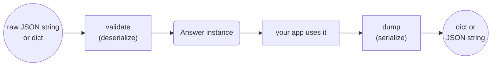

*Part 1 of 2. [Part 2](https://jairamhegde.in/writing/pydantic-validation-part-2) covers the rest of the toolkit. Every example was run against Pydantic 2.14.1 on Python 3.14.*
## My agents wrote all my parsing code

I build GenAI features. Most of them end the same way. An LLM returns JSON, and some code turns that JSON into a Python object the rest of the app can use.

I never wrote that code myself. I asked a coding agent, it produced a Pydantic model and a few lines around it, the tests passed, and I moved on. I knew the shape of the idea. Data comes in, something validates it, you get a Python object, and later you turn it back into JSON. I had never typed `model_validate_json` with my own hands.

Pico: "So the knowledge lived in the agent's context window. Convenient, until someone closes the tab."

## The task that took away the agent

Then an interviewer gave me this:

> An LLM was asked to return JSON like:
>
> ```json
> {"answer": "Paris", "confidence": 0.92, "sources": ["doc1", "doc7"]}
> ```
>
> 1. Fill in the Pydantic model `Answer`:
>    - `answer`: a string, required.
>    - `confidence`: a float, required, between 0.0 and 1.0 inclusive.
>    - `sources`: a list of strings, optional, defaults to an empty list.
> 2. Write `parse_answer(raw)`: turn the raw string into an `Answer`.
>    - If `raw` is not valid JSON, or the data fails validation, raise `InvalidLLMOutput` (already defined). Never let a `json` or Pydantic error escape.

It's three fields and one function. An agent would finish it in seconds.

## Three places I got stuck

I got stuck on every part of it.

The model came first. The spec said `sources` was "optional", so I declared it `Optional`. That turned out to be wrong, and I'll show why below.

Next, loading the raw string. I didn't know whether Pydantic wanted a dict or a string. I didn't know whether I should call `json.loads` first, or which method to call after that.

Last, the errors. "Never let a `json` or Pydantic error escape" means catching something and raising something else. I didn't know which exception Pydantic raises, or whether bad JSON raises the same one.

I could draw the data lifecycle on a whiteboard. I couldn't name one method that runs a step of it.

Pico: "Wait. Did you know Pydantic, or did you know where to ask about it?"

That question is fair, and it's why this post exists. I went back afterwards and rebuilt the solution one experiment at a time, so I would understand each line instead of recognizing it. The rest of this post is those experiments, in order. Each code block runs on its own. Install Pydantic (`pip install pydantic`) and run them as you read.

## What am I actually checking?

Before any Pydantic, take a function with no validation at all:

```python
def charge_user(amount: float):
    return amount * 1.18
```

The type hint says `float`, but Python doesn't enforce it. Call this with `-500`, `"hello"` or `0` and think about what happens. `"hello" * 1.18` raises a `TypeError` in the middle of the calculation. `-500` returns a negative charge with no error at all. `0` might be fine. The function quietly assumes that `amount` is a sensible number, and nothing checks that assumption.

That's all data validation is. You check that incoming data meets the assumptions your code is about to rely on.

The useful habit is knowing when to check. The trigger I use now is the moment I'm about to trust data that something else produced.

| Situation | What can go wrong |
|---|---|
| API request arrives | Missing fields, wrong types, malformed input |
| Environment config loads | Invalid port, missing API URL |
| Database row is read | Old rows break assumptions in today's code |
| LLM returns structured output | Wrong format, missing keys, invalid values |
| Background job receives a message | A bad payload crashes the worker |
| Payment starts | Negative amount, unsupported currency |

The LLM row is the interview task. The model produced the string, so my code shouldn't trust it.

## Four fields and three questions

Back to my `Optional` mistake. Pydantic builds a field from a type annotation plus an optional default. Here is a model with every combination that matters:

```python
from pydantic import BaseModel

class User(BaseModel):
    name: str                   # A
    nickname: str | None        # B
    role: str = "user"          # C
    bio: str | None = None      # D
```

Before you run anything, predict what happens to each field when the client leaves it out. Then try it:

```python
from pydantic import BaseModel, ValidationError

class User(BaseModel):
    name: str
    nickname: str | None
    role: str = "user"
    bio: str | None = None

try:
    User.model_validate({})
except ValidationError as e:
    print(e)
# 2 validation errors for User
# name
#   Field required [type=missing, input_value={}, input_type=dict]
# nickname
#   Field required [type=missing, input_value={}, input_type=dict]
# (each error also prints a docs link, trimmed here)

print(User.model_validate({"name": "Alex", "nickname": None}))
# name='Alex' nickname=None role='user' bio=None
```

`nickname` is the surprise. It accepts `None`, but you still have to send it. A field can do both.

Each field answers three separate questions, and mixing them up caused my mistake:

1. **Must the client send it?** This is about presence: required or not required.
2. **Can the value be `None`?** This is about allowed values: nullable or non-nullable. `| None` in the type is the only thing that decides it.
3. **What happens if the client leaves it out?** This is about the default. In Pydantic, a field with no default is required. A field with a default uses it.

| Field | Must the client send it? | Can it be `None`? | If omitted |
|---|---|---|---|
| A: `name: str` | Yes | No | Validation error |
| B: `nickname: str \| None` | Yes | Yes | Validation error |
| C: `role: str = "user"` | No | No | `"user"` |
| D: `bio: str \| None = None` | No | Yes | `None` |

`Optional[X]` is just another spelling of `X | None`. It answers question 2 and says nothing about question 1. Here is my interview model:

```python
from typing import Optional
from pydantic import BaseModel, ValidationError

class Answer(BaseModel):
    answer: str
    confidence: float
    sources: Optional[list[str]]

try:
    Answer.model_validate_json('{"answer": "Paris", "confidence": 0.92}')
except ValidationError as e:
    print(e.errors()[0]["type"], e.errors()[0]["loc"])
# missing ('sources',)
```

It's field B. I made `sources` nullable and left it required. That's the opposite of what the spec asked for.

Pico: "Optional, the word, and `Optional`, the type, have never met."

Now run the three questions on the spec. Must the client send `sources`? No. Can it be `None`? The spec says "a list of strings", so no. If it's omitted? An empty list. That's field C, a non-nullable type with a default:

```python
from pydantic import BaseModel, Field

class Answer(BaseModel):
    answer: str
    confidence: float
    sources: list[str] = Field(default_factory=list)

print(Answer.model_validate_json('{"answer": "Paris", "confidence": 0.92}'))
# answer='Paris' confidence=0.92 sources=[]
```

`sources: list[str] = []` would also work, because Pydantic copies mutable defaults for each instance. `Field(default_factory=list)` says the same thing explicitly, and it's the form a reviewer expects to see.

There is one more combination that looks like field D but isn't. `x: str = None` gives the field a `None` default without allowing `None` in the type. Pydantic doesn't validate defaults, so leaving the field out works and gives you `None`. Sending `{"x": null}` fails with `string_type`. Write `str | None = None` when you mean field D.

## Keeping confidence between 0 and 1

`confidence` must sit between 0.0 and 1.0 inclusive. A plain `float` lets anything through. `Field` adds constraints to the type:

```python
from pydantic import BaseModel, Field, ValidationError

class Answer(BaseModel):
    answer: str
    confidence: float = Field(ge=0.0, le=1.0)
    sources: list[str] = Field(default_factory=list)

for raw in [
    '{"answer": "Paris", "confidence": 1.7}',
    '{"answer": "Paris", "confidence": "high"}',
    '{"answer": "Paris", "confidence": "0.92"}',
]:
    try:
        print("ok:", Answer.model_validate_json(raw))
    except ValidationError as e:
        print("error:", e.errors()[0]["type"])
# error: less_than_equal
# error: float_parsing
# ok: answer='Paris' confidence=0.92 sources=[]
```

`ge` means greater than or equal, and `le` means less than or equal. `gt` and `lt` are the exclusive versions.

The third result is worth a look. The LLM sent `"0.92"` as a string, and Pydantic converted it to a float without complaint. By default Pydantic runs in lax mode, so it converts a value whenever the conversion can't lose information. For LLM output this usually helps, because models often quote numbers. Part 2 shows how to switch it off.

Pico: "So the validator does some of the cleanup for you. Make sure that's what you wanted."

You may see `Field(..., ge=0.0, le=1.0)` in other code. The `...` marks the field as required. Leaving out the default does the same thing, so I leave it out.

## Two ways to read the raw string

The input is a string, not a dict. My first instinct was the standard library:

```python
import json

raw = 'Sure! Here is the JSON: {"answer": "Paris", "confidence": 0.92}'
try:
    json.loads(raw)
except json.JSONDecodeError as e:
    print(type(e).__name__, "-", e)
# JSONDecodeError - Expecting value: line 1 column 1 (char 0)
```

That chatty prefix is a classic LLM failure, and `json.loads` catches it. Validation is still a separate step. You would call `Answer.model_validate(data)` on the dict, which can raise a different exception. That's two calls and two exception types.

Pydantic can read the string itself:

```python
from pydantic import BaseModel, Field, ValidationError

class Answer(BaseModel):
    answer: str
    confidence: float = Field(ge=0.0, le=1.0)
    sources: list[str] = Field(default_factory=list)

raw = 'Sure! Here is the JSON: {"answer": "Paris", "confidence": 0.92}'
try:
    Answer.model_validate_json(raw)
except ValidationError as e:
    print(e.errors()[0]["type"])
# json_invalid
```

Bad JSON comes back as a `ValidationError` with type `json_invalid`. It's the same exception as a wrong shape or an out-of-range value. One call covers both failures in the task.

That gives me the vocabulary I was missing in the interview. Each step of the lifecycle has a method:



| Step | Method | Input | Output |
|---|---|---|---|
| Validate a dict | `Answer.model_validate(data)` | Python dict | `Answer` instance |
| Validate a JSON string | `Answer.model_validate_json(raw)` | `str` or `bytes` | `Answer` instance |
| Dump to a dict | `answer.model_dump()` | instance | Python dict |
| Dump to a JSON string | `answer.model_dump_json()` | instance | `str` |

Deserialization is the incoming direction and serialization is the outgoing one. Part 2 covers the outgoing side.

## Reading the error

When validation fails, Pydantic doesn't stop at the first problem. It collects every error into one `ValidationError`:

```python
from pydantic import BaseModel, Field, ValidationError

class Answer(BaseModel):
    answer: str
    confidence: float = Field(ge=0.0, le=1.0)
    sources: list[str] = Field(default_factory=list)

try:
    Answer.model_validate_json('{"answer": 3, "confidence": 2}')
except ValidationError as e:
    print(e.error_count())
    for err in e.errors(include_url=False):
        print(err)
# 2
# {'type': 'string_type', 'loc': ('answer',), 'msg': 'Input should be a valid string', 'input': 3}
# {'type': 'less_than_equal', 'loc': ('confidence',), 'msg': 'Input should be less than or equal to 1', 'input': 2, 'ctx': {'le': 1.0}}
```

Each error is a dict with the same keys:

| Key | Meaning |
|---|---|
| `type` | Machine-readable error code, such as `missing`, `less_than_equal` or `json_invalid` |
| `loc` | Where the error is, as a path. Nested models give longer paths like `('citations', 1, 'quote')` |
| `msg` | Human-readable message |
| `input` | The value that failed |
| `ctx` | Extra details, such as `{'le': 1.0}` |
| `url` | Link to the docs for that error type (left out above with `include_url=False`) |

`e.errors()` is the structured version for code to read. `str(e)` is the readable version for people, and `e.json()` gives the errors as a JSON string.

One fact surprised me. `ValidationError` is a subclass of `ValueError`, and so is `json.JSONDecodeError`. A bare `except ValueError` catches both, along with every unrelated `ValueError` in the call. Name the exceptions you mean.

## `parse_answer`, line by line

With those pieces in place, the solution is short:

```python
from pydantic import BaseModel, Field, ValidationError


class InvalidLLMOutput(Exception):
    """Raised when the LLM's reply can't be turned into an Answer."""


class Answer(BaseModel):
    answer: str
    confidence: float = Field(ge=0.0, le=1.0)
    sources: list[str] = Field(default_factory=list)


def parse_answer(raw: str) -> Answer:
    try:
        return Answer.model_validate_json(raw)
    except ValidationError as e:
        raise InvalidLLMOutput(str(e)) from e
```

`model_validate_json` reads and validates in one call, so a single `except ValidationError` covers both bad JSON and bad data. `raise ... from e` gives the caller only `InvalidLLMOutput`, as the spec requires, and keeps the original Pydantic error on `__cause__` for logs and debugging.

Here it is against the failures I could think of:

```python
from pydantic import BaseModel, Field, ValidationError


class InvalidLLMOutput(Exception):
    pass


class Answer(BaseModel):
    answer: str
    confidence: float = Field(ge=0.0, le=1.0)
    sources: list[str] = Field(default_factory=list)


def parse_answer(raw: str) -> Answer:
    try:
        return Answer.model_validate_json(raw)
    except ValidationError as e:
        raise InvalidLLMOutput(str(e)) from e


cases = {
    "valid": '{"answer": "Paris", "confidence": 0.92, "sources": ["doc1", "doc7"]}',
    "no sources": '{"answer": "Paris", "confidence": 0.92}',
    "chatty prefix": 'Sure! {"answer": "Paris", "confidence": 0.92}',
    "truncated": '{"answer": "Par',
    "missing answer": '{"confidence": 0.92}',
    "confidence > 1": '{"answer": "Paris", "confidence": 1.2}',
    "null sources": '{"answer": "Paris", "confidence": 0.5, "sources": null}',
}

for name, raw in cases.items():
    try:
        print(f"{name:15} ok    {parse_answer(raw)!r}")
    except InvalidLLMOutput as e:
        print(f"{name:15} error {e.__cause__.errors()[0]['type']}")
# valid           ok    Answer(answer='Paris', confidence=0.92, sources=['doc1', 'doc7'])
# no sources      ok    Answer(answer='Paris', confidence=0.92, sources=[])
# chatty prefix   error json_invalid
# truncated       error json_invalid
# missing answer  error missing
# confidence > 1  error less_than_equal
# null sources    error list_type
```

If you take the `json.loads` route instead, you need to catch both exception types:

```python
import json
from pydantic import BaseModel, Field, ValidationError


class InvalidLLMOutput(Exception):
    pass


class Answer(BaseModel):
    answer: str
    confidence: float = Field(ge=0.0, le=1.0)
    sources: list[str] = Field(default_factory=list)


def parse_answer(raw: str) -> Answer:
    try:
        return Answer.model_validate(json.loads(raw))
    except (json.JSONDecodeError, ValidationError) as e:
        raise InvalidLLMOutput(str(e)) from e


print(parse_answer('{"answer": "Paris", "confidence": 0.92}'))
# answer='Paris' confidence=0.92 sources=[]
```

Both versions pass the spec. I'd pick the first one, because there's one fewer step and one fewer exception to remember.

Pico: "Four lines of function body. The agent would have written the same four, and you would have learned nothing."

## The third failure: valid JSON, wrong answer

My original notes listed three ways an LLM response goes wrong. The interview covered two of them, broken JSON and the wrong shape. The third is a response that parses and has the right shape but still shouldn't be trusted. An answer of `"   "` passes `str`. A confidence of `"92%"` fails `float`, even though the meaning is clear. A confidence of 0.95 with no sources is valid by the types but suspicious for a RAG system.

Types and `Field` constraints can't express those rules. Validators can.

```python
from typing import Self
from pydantic import BaseModel, Field, ValidationError, field_validator, model_validator


class Answer(BaseModel):
    answer: str
    confidence: float = Field(ge=0.0, le=1.0)
    sources: list[str] = Field(default_factory=list)

    @field_validator("confidence", mode="before")
    @classmethod
    def percent_to_fraction(cls, v):
        # Runs on the raw input, before float conversion and the ge/le check.
        if isinstance(v, str) and v.strip().endswith("%"):
            return float(v.strip().rstrip("%")) / 100
        return v

    @field_validator("answer")
    @classmethod
    def answer_not_blank(cls, v: str) -> str:
        # Runs after Pydantic has confirmed v is a str.
        v = v.strip()
        if not v:
            raise ValueError("answer is empty")
        return v

    @model_validator(mode="after")
    def confident_answers_need_sources(self) -> Self:
        # Runs on the finished instance, so it can compare fields.
        if self.confidence >= 0.8 and not self.sources:
            raise ValueError("confidence >= 0.8 requires at least one source")
        return self


for raw in [
    '{"answer": "Paris", "confidence": "92%", "sources": ["doc1"]}',
    '{"answer": "Paris", "confidence": "150%", "sources": ["doc1"]}',
    '{"answer": "   ", "confidence": 0.3}',
    '{"answer": "Paris", "confidence": 0.95}',
]:
    try:
        print("ok:", Answer.model_validate_json(raw))
    except ValidationError as e:
        err = e.errors()[0]
        print("error:", err["loc"], err["msg"])
# ok: answer='Paris' confidence=0.92 sources=['doc1']
# error: ('confidence',) Input should be less than or equal to 1
# error: ('answer',) Value error, answer is empty
# error: () Value error, confidence >= 0.8 requires at least one source
```

Look at the `"150%"` case. The `before` validator turned it into `1.5`, and then the `le=1.0` constraint rejected it. A `before` validator only prepares the input. Every check after it still runs.

The other things I learned from running this:

- A `field_validator` sees one field. Use `mode="before"` to clean up raw input, and the default `mode="after"` for rules that need the real type.
- A `model_validator(mode="after")` receives the whole instance as `self`, so it's where rules that compare fields go. It must `return self`. Its errors have an empty `loc`, because they belong to the model and not to one field.
- Inside a validator, raise `ValueError` (or `AssertionError`). Pydantic wraps it into the `ValidationError`. Don't raise `ValidationError` yourself.
- `@classmethod` under `@field_validator` is the documented style. If you forget it, Pydantic 2.14 adds it for you. Some older posts say leaving it off is an error, but it isn't anymore.

Here is the decision table I put together afterwards:

| What you need | Tool |
|---|---|
| Numeric or length bounds | `Field(ge=0, le=1)`, `Field(min_length=1)` |
| A string format | `Field(pattern=r"^doc\d+$")` |
| Clean up one field's raw input | `@field_validator("x", mode="before")` |
| A business rule on one field | `@field_validator("x")` (after is the default) |
| A rule that compares fields | `@model_validator(mode="after")` |
| Reshape the whole raw payload | `@model_validator(mode="before")` (rare) |

Pico: "Note what none of these check. Whether Paris is actually the answer."

He's right. Pydantic validates structure and rules you can write down. It can't tell you the LLM answered the right question. That still needs evals, grounding checks or a human.

## Send the error back to the model

In production you often don't want to give up on the first bad response. Since `e.errors()` is structured, it can become the next prompt:

```python
from pydantic import BaseModel, Field, ValidationError


class Answer(BaseModel):
    answer: str
    confidence: float = Field(ge=0.0, le=1.0)
    sources: list[str] = Field(default_factory=list)


def build_retry_prompt(error: ValidationError) -> str:
    lines = ["Your previous reply was rejected. Fix these problems and return only JSON:"]
    for err in error.errors():
        field = ".".join(str(part) for part in err["loc"]) or "(whole reply)"
        lines.append(f"- {field}: {err['msg']}")
    return "\n".join(lines)


try:
    Answer.model_validate_json('{"answer": 42, "confidence": 1.4}')
except ValidationError as e:
    print(build_retry_prompt(e))
# Your previous reply was rejected. Fix these problems and return only JSON:
# - answer: Input should be a valid string
# - confidence: Input should be less than or equal to 1
```

Put a limit on the retry loop, two or three attempts, and raise `InvalidLLMOutput` when it runs out.

## How to do this in your own code

1. Write down what the LLM is supposed to return, field by field.
2. For each field, answer the three questions: must it be sent, can it be `None`, and what's the default. Then pick the annotation from the A/B/C/D table.
3. Add `Field` constraints for bounds, lengths and patterns.
4. Add validators only for rules that constraints can't express.
5. Parse with `Model.model_validate_json(raw)`. Catch `ValidationError` at one boundary and re-raise your own exception with `from e`.
6. Keep a list of real bad responses as test cases, like the `cases` dict above, and add to it every time the LLM surprises you.

## What I took from it

The interview task wasn't hard. I failed it because I had the concepts but not the method names, and I'd never run a single experiment to connect the two. Each mistake I made fits one step of the lifecycle. The model was wrong because I mixed up "may be left out" with "may be `None`". Loading failed because I didn't know `model_validate_json` existed. Error handling failed because I didn't know Pydantic puts bad JSON and bad data into one exception.

I still use agents for this code. Now I read what they write, and I can tell when `Optional` means the wrong thing.

[Part 2](02-pydantic-toolkit-for-llm-output.md) uses the same `Answer` model to test the rest of the toolkit: extra keys, renamed keys, responses with two possible shapes, nested citations, and turning models back into JSON.
